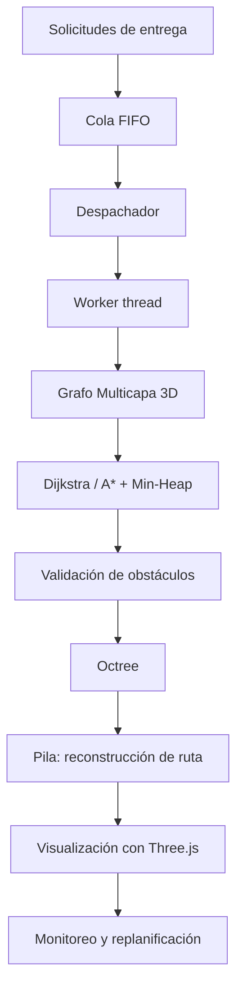

<div align="center">


### 🛸 Enrutamiento 3D Multicapa para Drones de Entrega Urbana en Loja

**Estructura de Datos · Tercer Ciclo · Unidades 1 y 2**


<br>


</div>

---

## 📌 Sobre el proyecto

Sistema de planificación de trayectorias tridimensionales para drones de entrega en el casco urbano de Loja.

La solución se basa en un **Grafo Multicapa 3D** que representa el espacio aéreo mediante nodos y aristas con costos asociados al consumo energético. Se complementa con **Octree** (obstáculos), **Cola FIFO** (pedidos), **Min-Heap** (Dijkstra/A*), **Pila** (reconstrucción de ruta), **Typed Arrays** y **Streams**, además de **worker threads** para no bloquear el Event Loop.

El propósito es demostrar cómo una selección adecuada de estructuras de datos resuelve problemas reales de rendimiento, memoria y eficiencia algorítmica.

## 🎯 Objetivos

- Implementar planificación de trayectorias 3D basada en grafos multicapa.
- Aplicar Tipos de Datos Abstractos (TDA) con estructuras eficientes en JavaScript.
- Optimizar memoria con Typed Arrays y lectura de archivos por Streams.
- Evaluar rendimiento temporal, consumo de memoria y precisión de las rutas.
- Comparar algoritmos de ordenamiento y búsqueda con mediciones reales (Unidad 2).
- Visualizar trayectorias y obstáculos con Three.js.

## ⚙️ Problemática

El espacio aéreo urbano de Loja tiene alturas, edificaciones y relieve que deben considerarse al planificar una ruta. Una representación ineficiente provoca:

- Alto consumo de memoria al almacenar miles de nodos.
- Retrasos al calcular trayectorias óptimas.
- Dificultad para detectar obstáculos tridimensionales.
- Bloqueos del Event Loop durante cálculos largos.
- Sobrecarga del Garbage Collector de V8.

## 🚀 Funcionalidades

- 🗺️ **Planificación de rutas:** trayectorias de mínimo consumo energético (Dijkstra / A*).
- 📦 **Gestión de entregas:** pedidos atendidos en orden de llegada con cola FIFO (RF-09).
- 🌬️ **Condiciones ambientales:** penalización por viento (RF-02).
- 🏙️ **Detección de obstáculos:** edificios, relieve y obstáculos en vuelo con Octree (RF-05).
- 🔋 **Consumo energético:** masa de la carga (RF-04) y cargadores (RF-07).
- 🛬 **Descenso lento** en la entrega (RF-06).
- 🔄 **Replanificación:** ruta alterna cuando se bloquea una arista (RF-08).
- 🌐 **Visualización 3D:** seguimiento del dron, ruta y métricas con Three.js (RF-03).

## 🧠 Estructuras de datos y algoritmos

| Estructura / Algoritmo | Aplicación en el proyecto |
|---|---|
| **Grafo Multicapa 3D** | Espacio aéreo como nodos y aristas ponderadas. |
| **Octree** | División del espacio 3D y detección de obstáculos. |
| **Dijkstra / A\*** | Trayectorias de costo mínimo. |
| **Min-Heap** | Cola de prioridad del buscador, O(log n). |
| **Cola FIFO circular** | Pedidos en orden de llegada, O(1). |
| **Pila (LIFO)** | Reconstrucción de la ruta origen → destino. |
| **Typed Arrays** | Almacenamiento compacto; nodo = entero, vecinos por aritmética. |
| **Streams** | Carga de mapas y edificios por líneas con memoria O(1). |
| **MergeSort / QuickSort** | Ordenamiento de edificios por altura y área (Unidad 2, Avance 1). |
| **Búsqueda secuencial vs binaria** | Pruebas de estrés en memoria y archivos indexados (Unidad 2, Avance 2). |

## 🏗️ Arquitectura conceptual



## ⚡ Cómo ejecutarlo

```bash
npm install
npm run datos        # genera datos DEMO en data/ (reemplázalos por datos reales de Loja)
npm run prueba       # verifica RF-01..RF-09 y las estructuras (solo necesita Node)
npm run benchmark    # mide "versión simple" vs "con estructura": evidencia para el informe
npm run server       # API en http://localhost:3000
npm run cliente      # visor 3D en http://localhost:5173 (en otra terminal)
```

## 📁 Mapa de archivos

| Archivo | Estructura / tópico | Qué hace |
|---|---|---|
| `server/estructuras/min-heap.js` | Cola de prioridad, O(log n) | Motor de Dijkstra/A* |
| `server/estructuras/cola-fifo.js` | Cola circular, O(1) | Pedidos en orden de llegada (RF-09) |
| `server/estructuras/octree.js` | Búsqueda espacial | Obstáculos estáticos y de sensores (RF-05, RNF-05) |
| `server/datos/cargador-stream.js` | Archivos y Streams, O(1) | Carga mapa y edificios por líneas |
| `server/grafo/malla.js` | TDA y Typed Arrays | Nodo = entero; vecinos por aritmética |
| `server/grafo/constructor.js` | Grafo multicapa | Bloquea nodos y aristas; agrega obstáculos en vuelo |
| `server/grafo/costo.js` | Función de costo | Energía: distancia, ascenso, viento (RF-02), peso (RF-04) |
| `server/rutas/buscador.js` | Camino mínimo | Dijkstra / A* con arreglos reutilizados (RNF-02) |
| `server/rutas/reconstruir.js` | Pila (LIFO) | Ruta en orden origen → destino |
| `server/rutas/planificador.js` | Reglas del negocio | Descenso lento (RF-06), cargadores (RF-07), ruta alterna (RF-08) |
| `server/pedidos/despachador.js` | Cola FIFO + Map | Asigna pedidos a workers |
| `server/workers/ruta-worker.js` | Event Loop | Calcula fuera del hilo de Express (RNF-01) |
| `server/index.js` | API | `POST /api/pedidos`, `GET /api/pedidos/:id`, `POST /api/obstaculos` |
| `cliente/*` | Visualización | Visor Three.js, seguimiento del dron (RF-03) |
| `pruebas/*` | Verificación | Pruebas de requisitos y benchmarks |

> Los archivos de la Unidad 2 (MergeSort, QuickSort, búsquedas) agrégalos a esta tabla con sus rutas reales.

## 🗂️ Formato de datos (para usar datos reales)

- `data/elevacion.csv`: 40 líneas × 40 valores (m s. n. m.), una por fila de la malla.
- `data/edificios.ndjson`: un JSON por línea `{xmin,ymin,xmax,ymax,zmax,altura}` en metros locales (usa `latLonAMetros` de `config.js`; `zmax` = terreno + altura).
- `data/cargadores.json`: `[{ "id": "C1", "fila": 10, "col": 10 }]`.

## 📊 Requisitos no funcionales

| Criterio | Meta técnica |
|---|---|
| Rendimiento | Rutas en grafos de hasta 10.000 nodos en menos de 2 s. |
| Memoria | Huella espacial O(n) con Typed Arrays. |
| Carga de archivos | Streams con consumo auxiliar O(1). |
| Precisión | Márgenes de seguridad respecto a edificaciones. |
| Arquitectura | Estructuras en módulos independientes. |
| Concurrencia | Cálculo en workers, sin bloquear Express (RNF-01). |

## 📈 Avances de la Unidad 2

- **Avance 1 – Ordenamiento:** MergeSort y QuickSort implementados desde cero (sin `.sort()`) sobre `edificios.ndjson` (167 registros), ordenando por altura descendente y área ascendente, con tiempos y memoria medidos.
- **Avance 2 – Búsqueda:** pruebas de estrés de búsqueda secuencial vs binaria en arreglos en memoria y archivos indexados, con al menos 3 escenarios (p. ej. 1.000, 50.000 y 500.000 registros) medidos con `performance.now()`.

## ⚠️ Límites conocidos

- Los datos incluidos son sintéticos; las constantes de energía de `config.js` son didácticas y deben calibrarse.
- El obstáculo en vuelo (RF-05) lo simula un botón; no hay sensor real.
- Una sola parada de carga por pedido; se asume carga completa.
- Los obstáculos dinámicos viven solo en memoria: reiniciar el servidor los borra.
- El clima (RF-02) es un viento uniforme, no un pronóstico real.

## 👥 Integrantes

| Integrante | Participación |
|---|---|
| Ariana Quezada | Integrante del equipo |
| Kiara Condoy | Integrante del equipo |
| Mateo Pucha | Integrante del equipo |
| _(completar)_ | Integrante del equipo |

## 📚 Información académica

- **Universidad:** Universidad Nacional de Loja
- **Facultad:** Energía, las Industrias y los Recursos Naturales No Renovables
- **Carrera:** Computación · **Nivel:** Tercer ciclo
- **Asignatura:** Estructura de Datos · **Grupo:** 10
- **Docente:** Ing. Cristian Narváez
- **Período académico:** Septiembre 2026 – Febrero 2027

## 🤖 Declaración de uso de IA

Se utilizaron herramientas de IA generativa como apoyo en redacción, corrección gramatical, maquetación y generación de código base. El diseño conceptual, la arquitectura, la selección de estructuras de datos y el análisis son de autoría humana y fueron revisados por el equipo.

## 📝 Conclusiones

- El Grafo Multicapa 3D, el Octree, las colas y el Min-Heap permiten abordar planificación de rutas, detección de obstáculos y gestión de pedidos.
- Typed Arrays, Streams y worker threads muestran la importancia de optimizar almacenamiento, procesamiento y concurrencia.
- Los benchmarks de ordenamiento y búsqueda respaldan con datos la elección de cada estructura.

---

<div align="center">

### ✨ Innovación que conecta estructuras de datos con el mundo real.


<sub>Universidad Nacional de Loja · Computación · 2026–2027</sub>

</div>