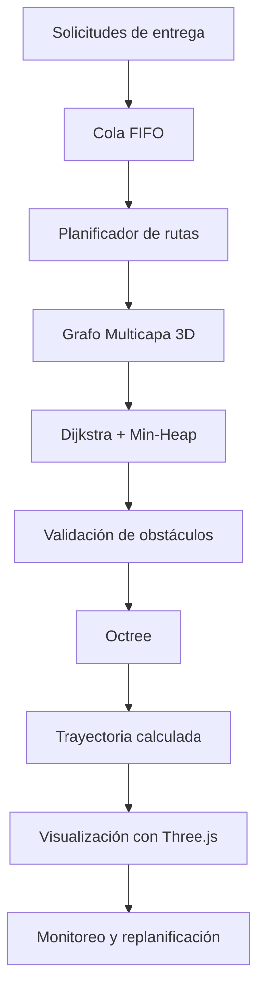

 

### 🛸 Enrutamiento 3D Multicapa para Drones de Entrega Urbana en Loja

**Estructura de Datos · Tercer Ciclo · Unidad 1**

 

---

## 📌 Sobre el proyecto

Este proyecto propone el diseño de un sistema de planificación de trayectorias tridimensionales para drones de entrega en el casco urbano de Loja.

La solución se fundamenta en un **Grafo Multicapa 3D**, que permite representar el espacio aéreo mediante nodos y aristas con costos variables asociados al consumo energético. Además, incorpora estructuras como Octree, Colas FIFO y Min-Heap para optimizar la búsqueda de rutas, gestionar solicitudes y evitar obstáculos.

El propósito es demostrar cómo una selección adecuada de estructuras de datos permite resolver problemas reales relacionados con el rendimiento, la memoria y la eficiencia algorítmica.

## 🎯 Objetivos

- Implementar una planificación de trayectorias 3D basada en grafos multicapa.
- Aplicar Tipos de Datos Abstractos (TDA) mediante estructuras eficientes en JavaScript.
- Optimizar el uso de memoria mediante Typed Arrays y lectura de archivos por Streams.
- Evaluar el rendimiento temporal, el consumo de memoria y la precisión de las rutas.
- Visualizar las trayectorias y los obstáculos mediante Three.js.

## ⚙️ Problemática

El espacio aéreo urbano de Loja presenta diferentes alturas, edificaciones y condiciones topográficas que deben considerarse al planificar una ruta.

Una representación ineficiente de estos datos puede provocar:

- Alto consumo de memoria al almacenar miles de nodos.
- Retrasos al calcular trayectorias óptimas.
- Dificultades para detectar obstáculos tridimensionales.
- Bloqueos del Event Loop durante cálculos prolongados.
- Sobrecarga del Garbage Collector de V8.

Por ello, se plantea utilizar estructuras de datos especializadas que permitan gestionar la información de manera eficiente.

## 🧠 Estructuras de datos y algoritmos

| Estructura / Algoritmo | Aplicación en el proyecto |
|---|---|
| **Grafo Multicapa 3D** | Representar el espacio aéreo mediante nodos y aristas ponderadas. |
| **Octree** | Dividir el espacio tridimensional y detectar obstáculos. |
| **Dijkstra** | Calcular trayectorias de costo mínimo. |
| **Min-Heap** | Gestionar la cola de prioridad de Dijkstra. |
| **Cola FIFO** | Procesar solicitudes de entrega en orden de llegada. |
| **Pila** | Reconstruir la trayectoria calculada. |
| **Typed Arrays** | Almacenar coordenadas y datos de forma compacta. |
| **Streams** | Procesar archivos de mapas por fragmentos. |

## 🚀 Funcionalidades propuestas

- 🗺️ **Planificación de rutas:** calcular trayectorias minimizando el consumo energético.
- 📦 **Gestión de entregas:** atender solicitudes mediante una cola FIFO.
- 🌬️ **Condiciones ambientales:** simular penalizaciones por viento.
- 🏙️ **Detección de obstáculos:** evitar edificios y elementos del relieve mediante Octree.
- 🔋 **Consumo energético:** considerar la masa de la carga y puntos de recarga.
- 🔄 **Replanificación:** recalcular la trayectoria cuando se bloquee una arista.
- 🌐 **Visualización 3D:** representar el dron, la ruta y las métricas mediante Three.js.

## 📊 Requisitos no funcionales

| Criterio | Meta técnica |
|---|---|
| Rendimiento | Calcular rutas en grafos de hasta 10.000 nodos en menos de 2 segundos. |
| Memoria | Mantener una huella espacial O(n) mediante Typed Arrays. |
| Carga de archivos | Procesar mapas mediante Streams con consumo auxiliar O(1). |
| Precisión | Mantener márgenes de seguridad respecto a edificaciones. |
| Arquitectura | Separar las estructuras de datos en módulos independientes. |

## 🏗️ Arquitectura conceptual

El sistema relaciona las estructuras de datos con las distintas etapas de planificación:

## 💻 Tecnologías y herramientas

| Tecnología | Uso |
|---|---|
| JavaScript | Implementación de estructuras y algoritmos. |
| Node.js | Entorno de ejecución del sistema. |
| V8 | Motor de ejecución de JavaScript. |
| Three.js | Visualización tridimensional. |
| WebGL | Renderizado gráfico 3D. |
| Visual Studio Code | Entorno de desarrollo. |
| Git y GitHub | Control de versiones y repositorio. |

## 📁 Organización del proyecto

El diseño contempla una separación modular entre la lógica del sistema y su representación visual:

- **Lógica en Node.js:** gestión de estructuras de datos, planificación y procesamiento.
- **Visualización en Three.js:** representación del espacio aéreo, obstáculos, drones y trayectorias.
- **Gestión de archivos:** lectura de mapas y elevaciones mediante Streams.

## 👥 Integrantes

| Integrante | Participación |
|---|---|
| Ariana Quezada | Integrante del equipo |
| Kiara Condoy | Integrante del equipo |
| Mateo Pucha | Integrante del equipo |

## 📚 Información académica

- **Universidad:** Universidad Nacional de Loja.
- **Facultad:** Energía, las Industrias y los Recursos Naturales No Renovables.
- **Carrera:** Computación.
- **Asignatura:** Estructura de Datos.
- **Nivel:** Tercer ciclo.
- **Unidad:** Unidad 1 – Actividad Autónoma AA1.
- **Docente:** Ing. Cristian Narváez.
- **Grupo:** 10.
- **Período académico:** Septiembre 2026 – Febrero 2027.

## 🤖 Declaración de uso de IA

Se utilizaron herramientas de Inteligencia Artificial Generativa como apoyo en tareas de redacción, corrección gramatical y maquetación del documento. El diseño conceptual, la arquitectura del software, la selección de estructuras de datos y el análisis presentado son de autoría humana.

## 📝 Conclusiones

- La aplicación de estructuras como el Grafo Multicapa 3D, Octree, Colas FIFO y Min-Heap permite abordar los desafíos de planificación de rutas, detección de obstáculos y gestión de solicitudes.
- El uso de Typed Arrays y Streams demuestra la importancia de optimizar el almacenamiento y procesamiento de grandes cantidades de información.
- La integración de algoritmos y estructuras de datos permite plantear una solución que relaciona la eficiencia computacional con las necesidades de la logística urbana.

---

### ✨ Innovación que conecta estructuras de datos con el mundo real.

Universidad Nacional de Loja · Computación · 2026–2027

